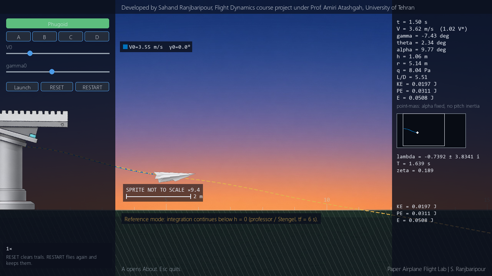

# Paper Airplane Flight Lab

Developed by Sahand Ranjbaripour, Flight Dynamics course project under Prof. Amiri Atashgah, University of Tehran

A 2D, side-view engineering lab for the point-mass paper airplane in Robert F. Stengel, *Flight Dynamics* (2005), Example 1.3-1. It reproduces the professor's four cases and is meant to show equilibrium glide, the phugoid, and why a fast throw loops. It is not a game: there is no score, crash, or sound.




## Features

- The professor's four-state point-mass model, with constant lift and drag coefficients.
- Pre-launch sliders for launch speed and flight-path angle, with presets A–D.
- Reference integration to 6 s (altitude may go below the ground) and Physical flight that stops at the ground.
- Playback of a precomputed trajectory, persistent trails, and RESET / RESTART overlay.
- A linearized phugoid overlay, a Monte Carlo throw scatter, and a landing-range heatmap.
- Matplotlib figures that follow the professor's two plots, plus a headless command-line export.

## Physics in one paragraph

The state is true airspeed \(V\), flight-path angle \(\gamma\), altitude \(h\), and range \(r\). Dynamic pressure is \(\tfrac{1}{2}\rho V^2\). Lift and drag use the constant coefficients at \((L/D)_{\max}\). The path equations are the professor's: drag and the gravity component change \(V\), lift and the gravity component change \(\gamma\), and \(\dot h = V\sin\gamma\), \(\dot r = V\cos\gamma\). The dart is drawn at the instantaneous pitch \(\theta = \alpha_* + \gamma\). Angle of attack stays at \(\alpha_*\). There is no pitch inertia, wind, or stall. Homework constants are \(S = 0.017\,\mathrm{m}^2\), \(AR = 0.86\), Oswald efficiency \(e = 0.9\), \(m = 0.003\,\mathrm{kg}\), \(g = 9.8\,\mathrm{m/s}^2\), \(\rho = 1.225\,\mathrm{kg/m}^3\), \(C_{D0} = 0.02\), and an initial height of \(2\,\mathrm{m}\).

## Install

Python 3.10 or newer.

```bash
python3 -m venv .venv
# Linux / macOS:
source .venv/bin/activate
# Windows (cmd):
.venv\Scripts\activate
# Windows (PowerShell):
.venv\Scripts\Activate.ps1
pip install -e ".[dev]"
python -m paper_airplane
```

## Run

```bash
python -m paper_airplane
```

`python main.py` does the same thing.

Headless figures, without opening the window:

```bash
python -m paper_airplane --reference-plots
python -m paper_airplane --heatmap
```

Generated plots and CSV files go under `outputs/` (gitignored).

## Controls

Before launch, sliders and the mouse set \(V_0\) and \(\gamma_0\). Tab cycles Reference, Physical, Phugoid, Monte Carlo, and Heatmap.

| Key | Action |
| --- | --- |
| 1 / 2 / 3 / 4 | Presets A, B, C, D |
| Tab | Cycle mode |
| Space or Enter | Launch |
| R | RESET (clear trails and legend, return to the launcher) |
| T | RESTART (return to the launcher, keep trails) |
| H | Drop A–D Reference trails |
| P | Show plots of the last run, or of A–D |
| E | Export the last run |
| A | About panel (close with A or Esc) |
| Esc | Close About, or quit prompt; during flight, abort and keep the partial trail |
| - / = or [ / ] | Playback speed 0.25× / 1× / 4× |

RESET clears trails. RESTART flies again and keeps them.

After a run, Space launches again from the current sliders and keeps existing trails.

## Outputs

Show plots opens the Matplotlib figures. Export writes PNG and CSV files into `outputs/run_YYYYMMDD_HHMMSS/`. The model notes are in [docs/theory.md](docs/theory.md) and the checks are in [docs/validation.md](docs/validation.md).

## Assumptions and limitations

- Point mass. Angle of attack is fixed. Pitch inertia is not in the model.
- \(C_L\) is constant. There is no stall model.
- No wind, gusts, or ground effect.
- Assumption: illustrative hand-throw scatter. In Monte Carlo mode the default speed jitter is \(0.20\,\mathrm{m/s}\) and the default angle jitter is \(3.0^\circ\). These sigmas are not from Stengel and not from a measured data set.
- Reference mode integrates to \(t = 6\,\mathrm{s}\) with no ground event, so altitude may be negative. Physical mode stops at \(h = 0\).

## References

- Stengel, R. F. (2005). *Flight Dynamics*. Princeton University Press. Example 1.3-1, Paper Airplane Flight Path.
- Paper Airplane Simulation: https://stengel.mycpanel.princeton.edu/PaperPlane.html
- PaperPlane.m (the professor's code): https://stengel.mycpanel.princeton.edu/PaperPlane.m
- MAE 331 Lecture 1: https://stengel.mycpanel.princeton.edu/MAE331Lecture1.pdf
- MAE 331 Lecture 3 (Helmbold): https://stengel.mycpanel.princeton.edu/MAE331Lecture3.pdf
- MAE 331 Lecture 11 (path equations): https://stengel.mycpanel.princeton.edu/MAE331Lecture11.pdf
- Book page: https://stengel.mycpanel.princeton.edu/FlightDynamics.html
- Lanchester, F. W. (1908). *Aerodonetics*. https://archive.org/details/aerodoneticscon02lancgoog
- MIT OCW 16.333: https://ocw.mit.edu/courses/16-333-aircraft-stability-and-control-fall-2004/
- MIT Unified Engineering phugoid notes: https://ocw.mit.edu/courses/16-01-unified-engineering-i-ii-iii-iv-fall-2005-spring-2006/4e932d24f9d4b17918820220ce1bd11e_phugoid.pdf
- SciPy RK23: https://docs.scipy.org/doc/scipy/reference/generated/scipy.integrate.RK23.html
- Li, Goodwill, Wang, Ristroph, *J. Fluid Mech.* (2022): https://www.cambridge.org/core/journals/journal-of-fluid-mechanics/article/centre-of-mass-location-flight-modes-stability-and-dynamic-modelling-of-gliders/D4983A693B836A364D19C95B4D5FFC3B
- Ng, Kng, Pey, Skvortsov, AIAA 2009-3958, On the Aerodynamics of Paper Airplanes: https://lactea.ufpr.br/wp-content/uploads/2018/08/On_the_Aerodynamics_of_Paper_Airplanes.pdf
- NASA Glenn, three forces on a glider: https://www1.grc.nasa.gov/beginners-guide-to-aeronautics/three-forces-on-a-glider/

## Asset attribution

The dart, dusk field, catapult, and scene preview are AI-generated images made for this project. They are not photographs. See [assets/ATTRIBUTION.md](assets/ATTRIBUTION.md).

## Author

Sahand Ranjbaripour (https://github.com/sahandrb).

## Acknowledgments

Course project for the Flight Dynamics course at the University of Tehran under Prof. Amiri Atashgah. The flight model follows Robert F. Stengel, *Flight Dynamics* (Princeton University Press, 2005), Example 1.3-1. Prof. Amiri Atashgah is the course supervisor, not a co-author of the software.
